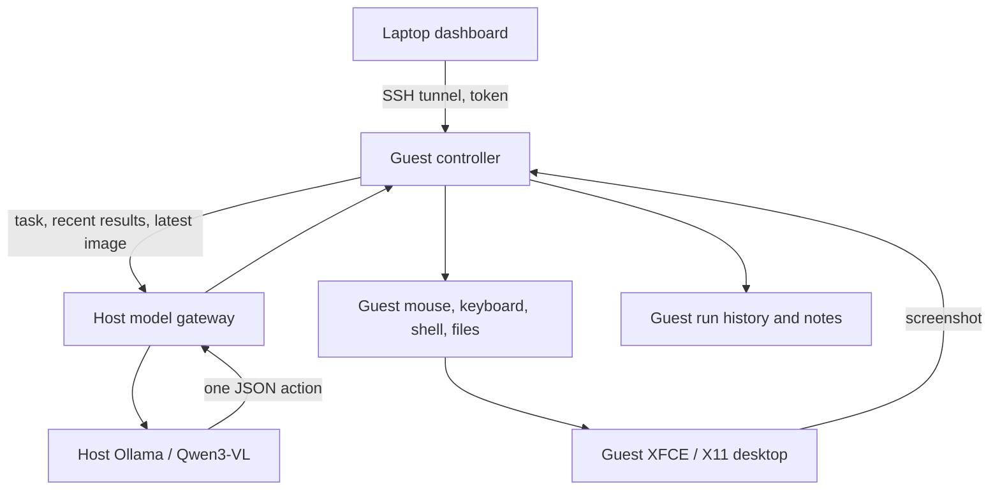

# Architecture and operation

The host runs only the model server and a restricted HTTP gateway. The Python controller runs in the guest alongside XFCE, Xvfb and Firefox. Every model-selected command or desktop action executes there.



## Decision loop

1. Capture the initial desktop, combine the task with current state, saved notes, and its step budget, and ask the model for one JSON action. The budget includes the current step, maximum steps, and steps remaining including the current step; it is a ceiling, not a target.
2. Validate the outer response and tool arguments. Invalid model text is never evaluated as Python or a shell command.
3. Check pause, stop, and elapsed-time limits before executing the action.
4. Execute the named tool, record the actual result, and capture a fresh screenshot after GUI work.
5. Feed bounded recent results and the newest state into the next decision. A `finish` action ends the task.

For shell/file/note actions the next prompt omits images, and previous coordinates are invalidated. The model requests a screenshot before returning to coordinate actions. Screenshot coordinates are mapped to the actual desktop when the image is downscaled.

Only a short action description is requested, alongside a compact working summary. The model does not need to generate a long reasoning transcript. JSON is constrained by Ollama's schema format and independently validated locally. The controller does not require native tool-call parsing from Qwen.

The response schema has a separate branch for each action, including its required arguments, types, ranges, and nonempty keyboard lists. Coordinate maxima match the attached screenshot. Argument errors identify the failed action, and the controller does not save a failed action's proposed working state as achieved progress. Typing validates the paste-key combination before changing the clipboard.

## State and boundaries

Run state is saved in SQLite under `~/.local/share/treics-agent/agent.db`. Events record proposed actions, results, errors and available inference metrics. A recent screenshot is overwritten under `runs/<id>/screen.jpg`, so screenshot storage does not grow with each step. Persistent notes are capped at 6,000 characters and supplied to future tasks; they are context, not weight updates or continuous model training.

The dashboard uses a bearer token, rejects cross-origin requests, and requires a control header for mutations. It contains no remote JavaScript or font dependencies. Only one task per controller is admitted; a process lock prevents the CLI and dashboard service from running separate controllers on the same data directory.

The guest has passwordless sudo to allow full control of its own OS. There are no shared host folders, host terminal tools, host credentials, or Docker socket mounts. Host firewall rules match only `virbr-treic` and leave other bridges alone. The gateway admits only selected models and chat/show/tags/version endpoints; it removes arbitrary model options, caps resource settings, and serializes inference. Disconnecting a cancelled request closes the upstream connection.

The VM can access the public Internet. Task scope and permitted accounts still come from the user. Prompt instructions help the model stay on task but are not a security boundary; KVM, the scoped network rules and the restricted gateway are the actual boundaries.

Pause takes effect at action boundaries. Stop cancels a model socket and the current shell process group; a GUI call already in progress may finish its small operation. Previous effects are not rolled back. Detached background programs need separate shutdown or a guest power-off. Controller restarts mark active runs interrupted and never restart old tasks automatically.

The controller also pauses likely loops after three matching actions within the last twelve attempts without an observed change. GUI loops compare screenshots, ignoring small cursor/blink changes; shell and read tools compare identical arguments and results. Changed screenshots/results or file/note writes reset the check. Model-written state and reason text do not count as progress. This is a heuristic: deliberate polling or commands with identical output may also pause, and some loops may escape detection. The dashboard shows the reason and records a `stalled` event. Resume clears the loop check, captures a fresh desktop, and requests a new decision with recovery guidance. Stop ends the run. Pause time still counts against the run's elapsed-time limit.

Repeated errors are tracked separately: three matching action/error messages within twelve attempts also pause the run, even when successful GUI actions or changed screenshots occur between failures. File/note writes or Resume reset this error check.

## Local development

The controller requires Python 3.11+ and Pillow. The desktop tools are `scrot`, `xdotool` and `xclip`. Linux X11 is required; this implementation does not control Windows or Wayland.

```bash
python3 -m venv .venv
.venv/bin/python -m pip install -e .
.venv/bin/python -m unittest discover -s tests -v
python3 -m compileall -q treics_agent scripts
bash -n scripts/*.sh
```

Use `treics-agent doctor --test-model` to verify the real guest and model. Unit/integration tests use a simulated X11 capture and local simulated Ollama service while exercising actual file, shell and network-controller behavior. They do not establish model intelligence, task success rates, CPU speed, or VM provisioning success on the R620.
