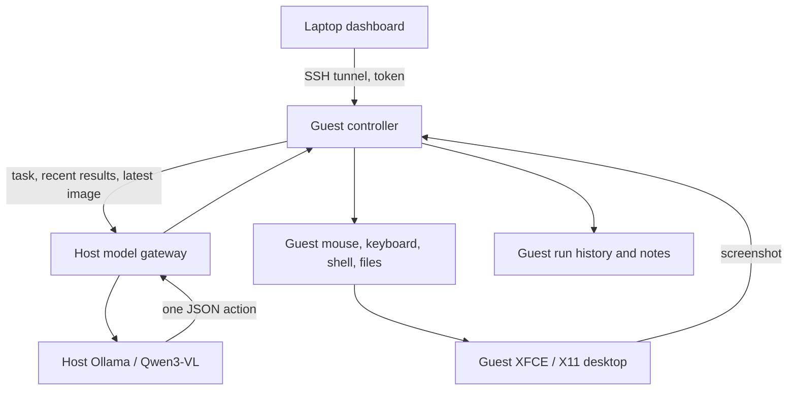

# Architecture and operation

The host runs only the model server and a restricted HTTP gateway. The Python controller runs in the guest alongside XFCE, Xvfb and Firefox. Every model-selected command or desktop action executes there.



## Decision loop

1. Capture the initial desktop, combine the task with current state, saved notes, and its step budget, and ask the model for one JSON action. The budget includes the current step, maximum steps, and steps remaining including the current step; it is a ceiling, not a target.
2. Validate the outer response and tool arguments. Invalid model text is never evaluated as Python or a shell command.
3. Check pause, stop, and elapsed-time limits before executing the action.
4. Execute the named tool, record the actual result, and capture a fresh screenshot after GUI work.
5. Feed compact observed results, fresh filesystem metadata, and the newest state into the next decision, with the current task last in the message. A `finish` action ends the task.

Model context excludes historical reason/state claims and failed action arguments. Successful arguments retain paths and control parameters, short command/text previews, and file-content sizes. Results retain exit status, output, and error messages, with long traceback source lines omitted. The full original events remain in the database and dashboard. No-image context is represented by `null`, rather than another instruction to request a screenshot.

Optional `task_checklist` mode adds a small, revisable plan and evidence IDs to model context. Its `set_checklist` action defines up to eight concrete tool-result checks; subsequent observations update their states without extra inference. The checklist is capped at 5,000 characters and is saved per run, separate from free-form working state. Ordinary decisions may include validated `checklist_updates` for blockers, reopening, or previous observations. Updates apply atomically before tool execution; rejected updates are logged as decisions that never executed and cannot be cited as tool evidence. Verification uses full stored events from the same run and rejects newer contradictions or recorded file changes. Checks based on evidence more than one hundred tool events old need fresh evidence rather than an unbounded scan.

Successful execution verifies only an execution criterion. It cannot independently establish result correctness, ethical behavior, or legality. Arbitrary shell writes and dependency changes require model-directed reopening; known file-tool changes reopen affected checks automatically. Finish remains available for blocked tasks, with unverified requirements appended to the run summary. The default-off mode omits checklist instructions, tools, schema fields and context from model requests. Configuration changes apply after restarting the controller and affect new runs; existing records preserve their mode and evidence.

Each decision also receives fresh metadata for the workspace and up to eleven recently referenced file/working-directory paths, including failed actions' paths. A shallow workspace listing is capped at twenty entries; metadata also has a character cap and reports omitted paths/entries. It does not read file contents or recurse. This lets the model distinguish a historical missing-directory error from the current existence of that directory. The diagnostic probes leave this optional live context absent to keep their comparisons controlled.

For shell/file/note actions the next prompt omits images, and previous coordinates are invalidated. The model requests a screenshot before returning to coordinate actions. Screenshot coordinates are mapped to the actual desktop when the image is downscaled.

Shell commands run with Bash `pipefail`, so a failed extraction or download inside a pipeline is not hidden by a successful final command. A shell action's proposed state is saved only when the command succeeds; its exit status and output remain in the activity log either way.

The shell validates `cwd` before starting Bash and explains that no part of the command ran when `cwd` is missing. Plain `mkdir -p` commands with simple unquoted paths report the observed directory postconditions; when all targets already exist, execution is skipped with explicit guidance to continue. Compound commands, shell expansions, quoted operands and other options retain normal Bash behavior. `write_file` creates parent directories and skips a rewrite when the existing bytes match exactly. Skips are logged, consume a decision step, and cannot replace working state with a new model claim of progress. Commands used for ordinary polling are not skipped.

Only a short action description is requested, alongside a compact working summary. The model does not need to generate a long reasoning transcript. JSON is constrained by Ollama's schema format and independently validated locally. The controller does not require native tool-call parsing from Qwen.

The response schema has a separate branch for each action, including its required arguments, types, ranges, and nonempty keyboard lists. Coordinate maxima match the attached screenshot. Argument errors identify the failed action, and the controller does not save a failed action's proposed working state as achieved progress. Typing validates the paste-key combination before changing the clipboard.

## State and boundaries

Run state is saved in SQLite under `~/.local/share/treics-agent/agent.db`. Events record proposed actions, results, errors and available inference metrics. A recent screenshot is overwritten under `runs/<id>/screen.jpg`, so screenshot storage does not grow with each step. Persistent notes are capped at 6,000 characters and supplied to future tasks; they are context, not weight updates or continuous model training.

The dashboard uses a bearer token, rejects cross-origin requests, and requires a control header for mutations. It contains no remote JavaScript or font dependencies. Only one task per controller is admitted; a process lock prevents the CLI and dashboard service from running separate controllers on the same data directory.

Polling retains existing activity-log DOM rows by event ID, preserving open Details panels and their internal scroll positions. New events append, expired events are removed, and selecting another run resets the list. Auto-scrolling is suspended while any Details panel is open. Checklist status appears separately from the event log.

The guest has passwordless sudo to allow full control of its own OS. There are no shared host folders, host terminal tools, host credentials, or Docker socket mounts. Host firewall rules match only `virbr-treic` and leave other bridges alone. The gateway admits only selected models and chat/show/tags/version endpoints; it removes arbitrary model options, caps resource settings, and serializes inference. Disconnecting a cancelled request closes the upstream connection.

The VM can access the public Internet. Task scope and permitted accounts still come from the user. Prompt instructions help the model stay on task but are not a security boundary; KVM, the scoped network rules and the restricted gateway are the actual boundaries.

Pause takes effect at action boundaries. Stop cancels a model socket and the current shell process group; a GUI call already in progress may finish its small operation. Previous effects are not rolled back. Detached background programs need separate shutdown or a guest power-off. Controller restarts mark active runs interrupted and never restart old tasks automatically.

The controller also pauses likely loops after three matching actions within the last twelve attempts without an observed change. GUI loops compare screenshots, ignoring small cursor/blink changes; shell and read tools compare identical arguments and results. Directory-setup comparisons ignore the message/skip flag so the transition from successful creation to existing-directory skips does not reset detection. Repeated identical file rewrites also count as no progress. Changed screenshots/results or actual file/note writes reset the check. Model-written state and reason text do not count as progress. This is a heuristic: deliberate polling or commands with identical output may also pause, and some loops may escape detection. The dashboard shows the reason and records a `stalled` event. Resume clears the loop check, captures a fresh desktop, and requests a new decision with recovery guidance. Stop ends the run. Pause time still counts against the run's elapsed-time limit.

Repeated errors are tracked separately: three matching action/error messages within twelve attempts also pause the run, even when successful GUI actions or changed screenshots occur between failures. Actual file/note writes or Resume reset this error check.

## Local development

The controller requires Python 3.11+ and Pillow. The desktop tools are `scrot`, `xdotool` and `xclip`. Linux X11 is required; this implementation does not control Windows or Wayland.

```bash
python3 -m venv .venv
.venv/bin/python -m pip install -e .
.venv/bin/python -m unittest discover -s tests -v
python3 -m compileall -q treics_agent scripts
bash -n scripts/*.sh
```

Use `treics-agent doctor --test-model` to verify the real guest and model. Unit/integration tests use a simulated X11 capture and local simulated Ollama service while exercising actual file, shell and network-controller behavior. They do not establish model intelligence, task success rates, CPU speed, or VM provisioning success on the R620.

To isolate history effects, stop the current task and run `.venv/bin/python scripts/diagnose-model.py` inside the guest. It makes two requests using the controller's prompt, action schema, model options, and gateway: a fresh-context script proposal and the same proposal with recent failed history. These standalone proposals disable the optional checklist aid for both cases without changing the saved configuration or runs, and the report identifies this choice. The probes omit screenshots and persistent notes in both cases and execute no proposed actions. The database is opened read-only. `--run-id` selects a specific run; otherwise it uses the most recent failed run among the last thirty. JSON output contains the requests, responses, and syntax checks; progress goes to stderr. Review the output before sharing because historical tool results may contain private information. Authorization headers and proxy tokens are not included.

`--compare-history-format` instead compares recovery of the current `~/agent-workspace/parser.py` using the selected run's task and state. Both requests contain identical compact observations and source data: one packs history in the current message, and one separates earlier action summaries into assistant messages and results into user observation messages. This experimental presentation is diagnostic-only; it does not change the dashboard agent. The probe offers four remaining diagnostic steps without changing the run's saved budget, and executes no actions.
